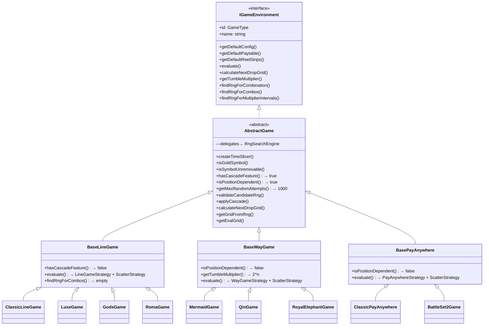

# RNG PAY — 系統架構、核心演算法與全方位開發指南（交接白皮書 v3.1）

> 本文件為 **RNG PAY** 系統的核心架構說明、各模組職責清冊、特殊遊戲規則、歷史踩坑防線與開發維護手冊。
> **所有接手本專案的 AI 助理或工程師，在進行任何開發、重構、新增遊戲或修復 Bug 前，必須完整閱讀並嚴格遵守本文件所列之規範與禁忌。**

---

## 0. 技術棧快照 (Technology Stack Snapshot)

| 分類 | 技術 / 版本 |
|------|------------|
| **語言** | TypeScript ~6.0 (target: ES2023) |
| **框架** | React 19 + Vite 8 |
| **CSS** | Tailwind CSS 4.3 (`@tailwindcss/postcss`) + PostCSS 8 |
| **狀態管理** | Zustand 5 (含 `persist` 中介層) |
| **Excel 解析** | exceljs 4 + xlsx 0.18 |
| **圖示** | lucide-react 1.17 |
| **CSV 解析** | papaparse 5 |
| **檔案下載** | file-saver 2 |
| **模組系統** | ESM (`"type": "module"`) |
| **建構工具** | Vite + `@vitejs/plugin-react` 6 |
| **靜態檢查** | ESLint 10 + typescript-eslint 8 |
| **單檔執行** | tsx 4 (`npx tsx <script>.ts`) |

---

## 1. 專案願景與核心價值 (Project Vision & Core Principles)

**RNG PAY** 是一個高精準度、高效能的老虎機 (Slot Machine) 數學模型驗證與測試輔助平台。主要服務於**老虎機數學設計師 (Math Designers)**、**前端/後端工程師**以及 **QA 測試工程師**：

1. **精準連線與贏分驗證**：支援經典連線 (Line Game)、多路連線 (Way Game / Megaways)、任意消除 (Pay Anywhere) 以及連線消除 (Line Cascade) 等多種數學模型。
2. **零干擾單一連線 RNG 自動產出**：能在毫秒級時間內，於數萬種排列組合中逆向搜尋出「剛好 N 連線」、「剛好特定百搭配對」，且**絕無額外符號干擾或多餘連線**的純淨盤面 RNG。
3. **消除型老虎機的雙重安全防線**：針對消除遞補機制，提供「掉落後零自連」與「新盤面遞補零消除（0 贏分）」的保證，產出 100% 乾淨的單次測試 RNG 數組。
4. **JIRA QA 測試報告與腳本庫一鍵生成**：支援自動將測試 RNG 格式化為自動化腳本、JIRA Bug 備註格式與全套測試案，大幅降低 QA 人工排查與重現問題的時間成本。

---

## 2. 完整目錄結構與模組職責清冊 (Full Directory & File Inventory)

> 以下結構經**逐一比對實際檔案系統**後生成，若新增或刪除檔案請同步更新。

```text
c:\github\Payline-RNG\
├── public/                              # 靜態公開資源
│   ├── favicon.svg                      # 網站 favicon
│   └── icons.svg                        # SVG 圖示集
├── src/
│   ├── App.tsx                          # 應用程式主進入點：Dashboard Grid 佈局 + 全域 Modal 工具
│   ├── App.css                          # App 層級微量 CSS（極少使用）
│   ├── main.tsx                         # React 渲染入口 (createRoot)
│   ├── index.css                        # 全域樣式：Tailwind 匯入 + 自訂主題色 + 動畫 keyframes
│   │
│   ├── core/
│   │   └── GameRegistry.ts              # 遊戲環境實例快取：依 games/registry.ts 的清單建立實例，getGame / tryGetGame
│   │
│   ├── games/                           # ★ 遊戲模組層（詳見第 4.3 章「遊戲隔離架構」）
│   │   ├── registry.ts                  #   ★ 唯一遊戲清單：選單 / 範本辨識 / traits / 腳本格式 皆由此取得
│   │   ├── ui-registry.ts               #   遊戲專屬 React UI 清單（與 registry 分開，Worker 不會載入 React）
│   │   ├── base/                        #   共用基底（★ 禁止出現具體遊戲 ID，ESLint 強制）
│   │   │   ├── IGameEnvironment.ts      #     介面合約 + 可選擴充點 (generateTriggerSequence / findRefillRng / postProcessWinningPositions)
│   │   │   ├── GameManifest.ts          #     ★ manifest 與 GameTraits 能力宣告的型別定義
│   │   │   ├── ScriptFormat.ts          #     QA 腳本格式 DefaultScriptFormatter（遊戲可覆寫）
│   │   │   ├── InstantGenerator.ts      #     MathID 即時產生器介面
│   │   │   ├── GameUi.ts                #     遊戲專屬 UI 擴充點型別
│   │   │   ├── generators/lineMathIdGenerator.ts  # 奢華 / 諸神共用的 MathID 產生器
│   │   │   ├── AbstractGame.ts          #     抽象基底類別：通用滾輪、消除掉落、RNG 搜尋委派、blocksSearchDraw
│   │   │   ├── BaseLineGame.ts / BaseWayGame.ts / BasePayAnywhere.ts
│   │   │   ├── RngSearchEngine.ts       #     ★ 通用 RNG 反向搜尋引擎 (只讀 traits，不判斷遊戲)
│   │   │   └── __tests__/               #     共用測試（詳見第 12.3 章）
│   │   │       ├── harness.ts           #       黃金樣本測試共用工具（載入範本、固定種子 withSeed、合成的通用 Pay Anywhere 滾輪表）
│   │   │       ├── flowRules.ts         #       ★ 獨立規則檢查器（不呼叫被測程式，自行依規格重算）
│   │   │       ├── knownIssues.ts / knownIssues.data.ts  # 已知問題白名單（精確計數）
│   │   │       ├── generator.rules.test.ts / generator.special.rules.test.ts  # 產生器 / COMBO / 大獎區間規則測試
│   │   │       └── scriptFormat.test.ts #       腳本格式快照
│   │   │
│   │   ├── 羅馬競技場 Roma/             #   linegame_roma
│   │   │   ├── RomaGame.ts              #     4 組滾輪表輪替、覆蓋式遞補、雙重安全防線、WX 特殊派彩、B1 規則
│   │   │   ├── manifest.ts              #     名稱 / 範本 / traits / 腳本格式
│   │   │   ├── script.ts                #     腳本：純 5 碼、初始 + 遞補連鎖、免遊觸發序列
│   │   │   ├── ui.tsx                   #     免遊觸發面板、模式切換、連鎖複製、RNG 預覽
│   │   │   └── __tests__/               #     黃金樣本 + 禁忌防線測試
│   │   ├── 諸神之戰 God of WarsThor VS Seth/ (linegame_gods)   # GodsGame / manifest / script / ui / __tests__
│   │   ├── 奢華 The Luxe/ (linegame_set2)   # LuxeGame / manifest / script / __tests__
│   │   ├── 決戰賽特2 Battle of Set 2Awakening/ (payanywhere_set2) # BattleSet2Game / manifest / script / generator / __tests__
│   │   ├── 秦皇傳說 Chin Shi Huang/ (waygame_qin)
│   │   ├── 皇家金象 Royal Ganesha/ (waygame_elephant)
│   │   ├── 人魚傳說 Mermaid/ (waygame)  # 人魚傳說 / Way Game 通用基底
│   │   ├── 通用線遊戲 linegame/ (linegame)  # Line Game 通用基底
│   │   └── 通用全盤消除 payanywhere/ (payanywhere)  # Pay Anywhere 通用基底
│   │
│   ├── flows/                           # ★ 流程層：分頁 / 工具背後的純函式（無 React，可單元測試）
│   │   ├── combinationWin.ts            #   「複製全部測案」Win= 公式：依遊戲類別的掉落與倍數規則掉落到底
│   │   ├── tumble.ts                    #   「消除掉落測試」載入 / 評估 / 掉落（TumbleViewerTab 使用）
│   │   ├── rngValidator.ts              #   「RNG 腳本驗證」解析 QA JSON 並逐步模擬（RngValidator 使用）
│   │   ├── rngFormat.ts                 #   isMathIdRng：判斷腳本 RNG 是 MathID 盤面還是滾輪停點
│   │   ├── classIds.ts                  #   QA 腳本 ClassIDs 解碼（金框 / Jackpot 座標、諸神 WY），腳本載入與驗證工具共用
│   │   ├── ballMultiplier.ts            #   盤面倍數球：F + L 加總乘全部贏分（traits.multiplierBalls）
│   │   ├── customGridSnippet.ts         #   自定義盤面存成測試腳本的 QA 內容
│   │   ├── lineViewer.ts                #   「贏分線路一覽」每條線找一組 RNG（LineViewerTab 使用）
│   │   └── __tests__/                   #   各流程規則測試 + 搜尋效能基準（第 12.3 章）
│   │
│   ├── components/                      # UI 元件目錄
│   │   ├── Sidebar.tsx                  # 左側選單欄：遊戲切換、範本載入、QA 工具入口
│   │   ├── ConfigPanel.tsx              # ★ 左側參數面板 (56KB)：滾輪表 / 賠率表 / 投注 / 特殊符號
│   │   ├── SlotConsole.tsx              # 中央模擬盤面主容器：管理 5 大功能子分頁切換與生命週期
│   │   ├── SlotGridDisplay.tsx          # 盤面符號格陣列渲染：金框/倍數球/Jackpot 標記
│   │   ├── MetricsDashboard.tsx         # 右側數據儀表板：RTP 模擬與命中率
│   │   ├── WelcomeScreen.tsx            # 首次進入或未載入遊戲時的引導畫面
│   │   ├── tabs/                        # 中央主功能分頁
│   │   │   ├── SlotGeneratorTab.tsx     #   ★ 核心 (126KB)：連線測試產生器 / 多連線組合清單 / 批次複製
│   │   │   ├── SlotManualTab.tsx        #   手動輸入 RNG 檢視盤面與贏分連線
│   │   │   ├── LineViewerTab.tsx        #   贏分線路一覽 (逐線展開、高亮顯示)
│   │   │   ├── TumbleViewerTab.tsx      #   消除掉落詳細歷程檢視器
│   │   │   └── SlotCustomGridTab.tsx    #   自定義任意符號擺盤與試算（僅 traits.customGridTab 的遊戲）
│   │   ├── ui/symbolTone.ts             # 盤面符號配色 symbolToneClass()
│   │   └── tools/                       # QA 輔助工具箱 (Modals)
│   │       ├── JiraReportGenerator.tsx      # JIRA 出詞 Bug List 產生器 (桌面版/標準版)
│   │       ├── JiraReportGeneratorWeb.tsx   # JIRA 出詞 Bug List 產生器 (Web 優化版)
│   │       ├── JiraBugListGenerator.tsx     # JIRA 出詞 BUG 備註工具
│   │       ├── JiraLinkGenerator.tsx        # JIRA 連結自動生成
│   │       ├── RtpCalculator.tsx            # RTP 模擬計算機
│   │       ├── RngValidator.tsx             # RNG 合法性驗證工具
│   │       └── SnippetLibrary.tsx           # 測試腳本庫 (自訂與常用腳本管理)
│   │
│   ├── store/                           # 全域狀態管理 (Zustand)
│   │   ├── useMachineStore.ts           # 機台基礎狀態：gameType / bet / coin / JIRA 全域暫存
│   │   ├── useGameStore.ts              # 遊戲運算狀態：滾輪表 / 賠率表 / 盤面 / 金框 / Snippet
│   │   ├── useSnippetStore.ts           # 測試腳本庫持久化狀態 (zustand/persist → localStorage)
│   │   └── __tests__/gameSwitch.test.ts # 切換遊戲重設測試
│   │
│   ├── hooks/                           # React Custom Hooks
│   │   ├── useRngSearch.ts              # 連線測試產生器的 React 包裝（防抖、狀態）
│   │   ├── generatorSearch.ts           # ★ 產生器搜尋流程純函式（COMBO / 大獎區間 / 即時產生器 / 反向搜尋分派）
│   │   ├── useSimulation.ts             # Web Worker 大量局數 RTP 模擬生命週期管理
│   │   ├── useSymbolGrouping.ts         # 符號分類群組 (高分/低分/特殊符號)
│   │   ├── useLinePaths.ts              # 贏分線 SVG 路徑（ResizeObserver，視窗縮放不跑版）
│   │   ├── useTheme.ts                  # 日夜主題切換
│   │   └── __tests__/generatorSearch.test.ts  # 產生器搜尋快照
│   │
│   ├── utils/                           # 工具函式庫
│   │   ├── evaluation.ts                # 盤面評估進入點 (evaluateGrid) + WinResult 定義 + 預設線路
│   │   ├── evaluation/                  # 評估子模組
│   │   │   ├── GameConstants.ts         #   符號常數、DEFAULT_WILD_SYMBOLS、金框/倍數球定義
│   │   │   ├── GameIntervals.ts         #   大獎倍數區間定義 (Big/Super/Mega/Ultra/Legend)
│   │   │   ├── WinningPositions.ts      #   計算中獎格子座標 (getWinningPositions)；遊戲專屬座標走 postProcessWinningPositions
│   │   │   └── strategies/              #   策略模式實作
│   │   │       ├── EvaluationStrategy.ts    # 策略介面：EvaluationContext + EvaluationStrategy
│   │   │       ├── LineGameStrategy.ts      # 經典 Payline 線路由左至右逐線判定
│   │   │       ├── WayGameStrategy.ts       # 243 Ways 多路連線笛卡兒積判定
│   │   │       ├── PayAnywhereStrategy.ts   # 任意位置收集消除判定
│   │   │       └── ScatterStrategy.ts       # Scatter 散佈符號判定（跨所有遊戲類型共用）
│   │   ├── excelParser.ts               # ★ 數學模型 Excel 檔解析：多 Sheet / 容錯；遊戲辨識改由 manifest 關鍵字
│   │   ├── svgPaths.ts                  # ★ 動態繪製中獎折線 SVG 座標計算器 (DOM 元素定位)
│   │   ├── rngSearch.ts                 # 搜尋函式封裝與轉發
│   │   ├── formatters.ts               # 數值、貨幣與字串格式化工具
│   │   └── __tests__/excelParser.test.ts  # 範本辨識測試
│   │
│   ├── constants/
│   │   └── GameConstants.ts             # 特殊符號 + 符號群組排序（遊戲清單已移至 games/registry.ts）
│   │
│   ├── types/                           # 全域型別定義
│   │   ├── core.ts                      # GameType 聯集 / GameConfig / SpecialSymbolConfig / MultiplierInterval
│   │   ├── evaluation.ts               # PaytableRule 介面
│   │   ├── simulation.ts               # SymbolMetric / SimulationResult 介面
│   │   └── index.ts                    # 型別匯出統一窗口
│   │
│   ├── workers/
│   │   ├── simulation.worker.ts         # Web Worker 執行緒：隔離執行百萬轉 RTP 運算
│   │   └── __tests__/simulation.worker.test.ts  # RTP 模擬快照（固定種子）
│   │
│   ├── mocks/                           # 預設 Mock / 範本資料
│   │   ├── defaultData.ts              # 預設 Mock 資料（各遊戲預設滾輪表/賠率表）
│   │   ├── originalDefaultData.ts      # 原始預設資料備份
│   │   └── parsedTemplates.ts          # 預先解析過的遊戲範本快取
│   │
│   └── assets/                          # 靜態圖片資源
│       └── hero.png, react.svg, vite.svg
│
├── scripts/
│   ├── parse-templates.cjs              # 預先解析遊戲範本的 Node.js 腳本
│   └── sandbox/                         # 早期解析實驗腳本（未被程式引用）
├── docs/
│   └── flow-test-report.md              # ★ 流程測試報告：規則測試結果、問題清單 F01~F17、搜尋最優性
├── templates/                           # Excel 遊戲範本檔案存放處（測試也讀這裡）
├── ARCHITECTURE.md                      # ★ 本文件
├── package.json                         # 套件依賴與腳本定義
├── vite.config.ts                       # Vite 建構配置
├── vitest.config.ts                     # 測試設定（npm test）
├── tsconfig.json / tsconfig.app.json / tsconfig.node.json / tsconfig.test.json
├── eslint.config.js                     # ESLint 配置
├── postcss.config.js                    # PostCSS 配置
└── index.html                           # Vite 入口 HTML
```

---

## 3. 核心型別系統 (Core Type System)

### 3.1 GameType 聯集（遊戲識別 ID）

```typescript
// src/types/core.ts
type GameType =
  | 'linegame'           // 經典通用線路遊戲
  | 'linegame_set2'      // 奢華 (Luxe)
  | 'linegame_gods'      // 諸神之戰
  | 'linegame_roma'      // 羅馬競技場
  | 'waygame'            // 經典 243 Ways (人魚傳說)
  | 'waygame_qin'        // 秦皇傳說
  | 'waygame_elephant'   // 皇家金象
  | 'megaway'            // Megaways（保留型別，尚無實作遊戲）
  | 'payanywhere'        // 經典全盤掉落
  | 'payanywhere_set2';  // 決戰賽特2
```

### 3.2 關鍵介面速查

| 介面 | 位置 | 職責 |
|------|------|------|
| `GameConfig` | `types/core.ts` | 遊戲配置：paylines、wildSymbols、goldFrames、jackpots、wyConfigs、specialRules |
| `PaytableRule` | `types/evaluation.ts` | 單一符號的賠率規則：symbolId、payouts、isWild、isScatter、mathId |
| `WinResult` | `utils/evaluation.ts` | 單次中獎結果：symbolId、matchCount、ways、payout、totalWin、lineIndex、multiplier |
| `SimulationResult` | `types/simulation.ts` | RTP 模擬結果：totalSpins、overallRTP、hitFrequency、symbolMetrics |
| `SpecialSymbolConfig` | `types/core.ts` | 特殊符號配置：S1/S2 開關與數量、金框倍數、幸運球、WY 開關 |
| `MultiplierInterval` | `types/core.ts` | 大獎倍數區間：id、name、min、max |
| `IGameEnvironment` | `games/base/IGameEnvironment.ts` | 遊戲環境介面合約（詳見第 4 章） |
| `GameManifest` / `GameTraits` | `games/base/GameManifest.ts` | 遊戲登記資料與能力宣告（詳見第 4.3 章） |
| `ScriptFormatter` | `games/base/ScriptFormat.ts` | QA 腳本 (RNG 字串) 格式 |
| `InstantGenerator` | `games/base/InstantGenerator.ts` | MathID 即時產生器 |
| `GameUi` | `games/base/GameUi.ts` | 遊戲專屬 UI 擴充點 |

---

## 4. 遊戲環境繼承體系 (Game Environment Class Hierarchy)



### 4.1 已實作的 9 款遊戲環境

| # | 類別 | GameType ID | 遊戲名稱 | 繼承基底 | 核心特色 |
|---|------|-------------|---------|----------|---------|
| 1 | `RomaGame` | `linegame_roma` | 羅馬競技場 | BaseLineGame | 15-line 消除、4 組滾輪表輪替、覆蓋式遞補、WX 特殊派彩、雙重安全防線 |
| 2 | `GodsGame` | `linegame_gods` | 諸神之戰 | BaseLineGame | WY 整軸展開 → 滿版 WX、倍數累加 (a/b/z 參數) |
| 3 | `LuxeGame` | `linegame_set2` | 奢華 | BaseLineGame | 金框翻倍 (F1~F4)、Jackpot (MINI/MAJOR/MEGA/MAXWIN)、S1 幸運草收集 |
| 4 | `ClassicLineGame` | `linegame` | 經典通用線路 | BaseLineGame | 純繼承，無自訂邏輯 |
| 5 | `MermaidGame` | `waygame` | 人魚傳說 | BaseWayGame | 經典 243 ways，最精簡的 WayGame |
| 6 | `QinGame` | `waygame_qin` | 秦皇傳說 | BaseWayGame | 243 ways + 金框→WX 轉換、S1 免遊中不消除 |
| 7 | `RoyalElephantGame` | `waygame_elephant` | 皇家金象 | BaseWayGame | R3/R4 金框→WX、B1/B2 不可消除、maxAttempts=30000 |
| 8 | `ClassicPayAnywhere` | `payanywhere` | 經典全盤掉落 | BasePayAnywhere | 純繼承，無自訂邏輯 |
| 9 | `BattleSet2Game` | `payanywhere_set2` | 決戰賽特2 | BasePayAnywhere | 平移掉落：上方符號整列下移、頂部補新符號 |

### 4.2 評估策略模式 (Strategy Pattern)

```text
                ┌─────────────────────────────────┐
                │   EvaluationStrategy (Interface) │
                │   evaluate(context, rule)        │
                └──────────┬──────────────────────┘
                           │
        ┌──────────────────┼──────────────────────┐
        ▼                  ▼                      ▼
  LineGameStrategy   WayGameStrategy    PayAnywhereStrategy
  (固定線路逐線判定)  (笛卡兒積多路判定)   (全盤收集消除判定)
                           │
                    ScatterStrategy (跨所有遊戲類型共用)
```

**關鍵設計**：
- `BaseLineGame.evaluate()` 組合使用 `LineGameStrategy` + `ScatterStrategy`
- `BaseWayGame.evaluate()` 組合使用 `WayGameStrategy` + `ScatterStrategy`
- `BasePayAnywhere.evaluate()` 組合使用 `PayAnywhereStrategy` + `ScatterStrategy`
- 每條線只保留最高贏分結果（`BaseLineGame` 中的 `lineWins Map` 去重邏輯）

### 4.3 ★ 遊戲隔離架構（Manifest / Traits / 擴充點）

**核心原則：共用程式碼只問「這款遊戲有沒有 X 能力」，永遠不問「是不是羅馬」。**
過去新增遊戲必須在 `SlotGeneratorTab`、`RngSearchEngine`、`WinningPositions`、Worker 等共用檔加 `gameType === 'linegame_xxx'`，
導致開發新遊戲時改壞同類型的舊遊戲。現在所有遊戲差異都集中在 `src/games/<遊戲>/`：

| 檔案 | 放什麼 | 由誰讀取 |
|------|--------|---------|
| `<Game>Game.ts` | 數學邏輯：evaluate、掉落、搜尋覆寫、擴充點實作 | `GameRegistry.getGame()` |
| `manifest.ts` | 顯示名稱、範本名稱、檔名關鍵字、**traits 能力宣告**、大獎區間、腳本格式、即時產生器 | `games/registry.ts` |
| `script.ts` | QA 腳本 (RNG 字串) 格式，繼承 `DefaultScriptFormatter` 覆寫需要的方法 | 產生器分頁 |
| `generator.ts` | MathID 即時產生器（不需反向搜尋滾輪表的遊戲） | `hooks/generatorSearch.ts` |
| `ui.tsx` | 只屬於這款遊戲的面板 / 按鈕（例：羅馬免遊觸發面板） | `games/ui-registry.ts` |
| `__tests__/` | 黃金樣本快照 + 該遊戲禁忌防線斷言 | `npm test` |

**GameTraits 速查**（`games/base/GameManifest.ts`，未設定 = 預設行為）：

| 類別 | Trait | 作用 / 目前使用的遊戲 |
|------|-------|----------------------|
| 家族 | `family` | `line` / `way` / `payanywhere` / `megaway`：連線判定、SVG 繪線、中獎座標、顯示文字 |
| 搜尋 | `searchPositionDependent` | 反向搜尋時要求從第 0 軸連續（Line 全部、waygame、皇家金象） |
| 搜尋 | `goldCascadeSearch` | 含百搭組合需有金框可轉 WX（秦皇、皇家金象） |
| 產生器 | `mathIdGenerator` | 以 MathID 參數驅動、無手動分頁（決戰賽特2、奢華、諸神） |
| 產生器 | `flatMathIdRng` / `cellMathIdLabel` / `ballMathIds` | 30 碼 MathID 腳本、格子顯示 MathID、15/19 = F1/L1（決戰賽特2；奢華有 ballMathIds） |
| 機制 | `goldFramesAndJackpots` / `cloverCollection` | 金框 + Jackpot 編輯器、S1 幸運草收集（奢華） |
| 機制 | `multiplierBalls` | F1~F4 倍數球設定（Pay Anywhere 類） |
| 機制 | `wyReels` | WY 整軸百搭 + (a,b,z) 倍數；產生器免遊用 WY（諸神） |
| 掉落 | `doublingTumbleMultiplier` | 連續掉落倍數 1,2,4,8…，免遊由 8 起跳、上限 1024（人魚、秦皇、皇家金象）；Worker / 產生器基礎倍數 / 消除掉落測試共用 |
| 掉落 | `simulationCascade` | RTP 模擬 Worker 中獎後掉落（人魚、秦皇、皇家金象、決戰賽特2、羅馬）；掉落方式由遊戲類別決定 |
| UI | `tumbleViewerTab` / `showPaylineTable` / `metricsPaylineCount` | 分頁與顯示差異 |
| UI | `customGridTab` | 提供「自定義盤面」分頁（可指定每格符號的 MathID 遊戲：奢華、諸神、決戰賽特2）；依滾輪表產生盤面的遊戲不提供，載入腳本時改帶入手動計算盤面 |
| 腳本 | `snippetClassIds` / `specialConfigFromGrid` | 測試腳本 ClassID 的解讀方式 |
| 賠率 | `rangedPayouts` / `combinedBonusSymbol` | match3~5 代表個數區間、B1/B2 合併選項（決戰賽特2） |

**IGameEnvironment 可選擴充點**（實作了 UI 就自動出現對應功能）：

| 方法 | 用途 | 實作 |
|------|------|------|
| `blocksSearchDraw(sym, target)` | 反向搜尋時哪些符號要避開 | 預設避開 B1/S1/S2；羅馬不避開 B1 |
| `applyCascade()` | 消除後的掉落 / 遞補（Worker 以外的掉落都走這裡，含測案 Win= 公式） | 秦皇（金框→WX）、皇家金象（R3/R4 金框→WX）、決戰賽特2（平移掉落）、羅馬（覆蓋式遞補） |
| `getTumbleMultiplier(n, isFG)` | 第 n 次掉落的倍數 | 預設 1；BaseWayGame 為 2^n（免遊 2^(n+3)），上限 1024 |
| `isSymbolUnremovable(sym, isFG)` | 中獎但不消除的符號 | 秦皇免遊 S1、皇家金象 B1/B2 |
| `hasCascadeFeature()` | 是否有掉落 | BaseLineGame 為 false（羅馬覆寫為 true） |
| `postProcessWinningPositions()` | 加入遊戲專屬的消除座標 | 羅馬：B1 少於 3 顆隨贏分消除 |
| `generateTriggerSequence()` | 免遊觸發序列 | 羅馬 |
| `findRefillRng()` | 「初始 + 遞補 0 贏分」連鎖腳本 | 羅馬 |
| `replayRefillChain()` | 重播「初始 + 遞補」連鎖腳本（RNG 腳本驗證工具使用） | 羅馬 |
| `simulateRefill()` / `getFreeSpinsByCombo()` | RTP 模擬的遞補方式、依連續消除次數給免遊 | 羅馬 |

### 4.4 共用層 vs 遊戲層：改東西前先問自己

```text
這個行為是「只有這款遊戲」才有？
  ├─ 是 → 寫在 src/games/<遊戲>/（覆寫方法 / script.ts / ui.tsx / manifest）
  └─ 否，是可重用的機制（金框、倍數球、整軸百搭…）
        → 在 GameTraits 新增旗標（預設值 = 舊行為），共用層讀旗標，只在需要的遊戲 manifest 打開
絕不：在共用層寫 gameType === 'xxx'（ESLint 會擋）
絕不：為了新遊戲修改 Base 類別的既有行為而不跑 npm test
```

---

## 5. 雙 Store 狀態架構與資料流向 (Dual-Store & Data Flow)

### 5.1 架構概覽

```text
                    ┌──────────────────────────────────┐
                    │       useMachineStore.ts          │
                    │      (機台層: 通用硬體設定)         │
                    │  gameType / bet / coin / isRunning │
                    │  loadTemplateTrigger               │
                    │  uploadedTemplateFile              │
                    │  activeModalTool                   │
                    │  JIRA 全域暫存 (3組: Desktop/Web/BugList) │
                    └───────────────┬──────────────────┘
                                    │ setGameType() 觸發遊戲切換
                                    ▼
                    ┌──────────────────────────────────┐
                    │        useGameStore.ts            │
                    │      (遊戲層: 專屬數學資料)         │
                    │  currentStrips / currentStripSets  │
                    │  currentFreeStripSets / activeStripId │
                    │  currentPaytable / currentGrid     │
                    │  rowCounts / reelCount              │
                    │  customPaylines                    │
                    │  specialSymbolConfig               │
                    │  goldFrames / jackpots / clovers    │
                    │  customGridData / customGridGoldFrames │
                    │  manualIndices / topTracker         │
                    │  isFreeGame / isProjectLoaded       │
                    │  projectName / pendingSnippet       │
                    └───────────────┬──────────────────┘
                                    │
         ┌──────────────────────────┼──────────────────────────┐
         ▼                          ▼                          ▼
   [ConfigPanel]              [SlotConsole]             [JIRA QA Tools]
   (參數調整/Excel匯入)       (5大分頁切換/盤面運算)      (測試報告/Bug備註)
```

### 5.2 第三個 Store：useSnippetStore

- 使用 `zustand/persist` 中介層，自動序列化至 `localStorage['snippet-storage']`
- 儲存測試腳本片段 (`Snippet`)，每個 Snippet 包含：`id`, `title`, `gameType`, `projectName`, `qaData`（含 RNGs / ClassIDs / LuckySelects / Selection）
- CRUD 操作：`addSnippet` / `updateSnippet` / `removeSnippet` / `clearSnippets`

### 5.3 資料流轉規則

1. **切換遊戲標準程序**：
   * 任何入口（側邊欄、歡迎頁、遊戲種類下拉、載入範本）都先呼叫 `useMachineStore.setGameType(newType)`
   * `useGameStore` 訂閱 gameType 變更，**自動**呼叫 `resetGameSpecifics()` — 清空：`currentStripSets`, `currentFreeStripSets`, `activeStripId`, `goldFrames`, `jackpots`, `specialSymbolConfig`, `manualIndices`, `manualIndicesOther`, `topTracker`, `topTrackerOther`, `isFreeGame`
   * 隨後從 `GameRegistry.getGame(newType)` 讀取 `getDefaultConfig()`, `getDefaultReelStrips()`, `getDefaultPaytable()` 並寫入 `useGameStore`

2. **Tab 惰性運算 (Lazy Calculation)**：
   * `SlotConsole.tsx` 中的子分頁只有在切換到 Active 狀態時才進行高負載的 DOM 渲染與 SVG 路徑計算，節省記憶體與避免主執行緒卡頓

3. **Snippet 套用流程**：
   * `useGameStore.applySnippet(snippet)` 以 `flows/rngFormat.ts` 的 `isMathIdRng()` 判斷 RNG 格式（MathID 盤面或滾輪停點）
     —— ⚠️ 不可用 `snippetClassIds` 判斷（通用 Line Game 的 ClassID 是座標式，但 RNG 是滾輪停點）
   * 解碼 `ClassIDs` 為金框倍數 / Jackpot / WY 配置（依 `traits.snippetClassIds`）
   * 有 `customGridTab` 的遊戲（MathID 盤面）→ 切到 `customGrid` 分頁；依滾輪表的遊戲 → 寫入 `manualIndices` 並切到 `manual` 分頁

---

## 6. 核心演算法深層解析 (Deep Dive into Algorithms)

### 6.1 RNG 反向搜尋引擎 (`RngSearchEngine.ts` — 35KB)

所有遊戲共用的搜尋核心，由 `AbstractGame` 委派調用。三大公開方法：

| 方法 | 目的 |
|------|------|
| `findRngForCombination()` | 搜尋「恰好 N 連線 + M 個 Wild」的候選 RNG |
| `findRngForCombos()` | 搜尋消除連鎖序列的多步 RNG |
| `findRngForMultiplierIntervals()` | 搜尋落入指定倍數區間的 RNG |

**搜尋策略**：
- 隨機取樣 + 爬山法優化
- 候選驗證：透過 `game.evaluate()` + `game.validateCandidateRng()` 確保零干擾
- 時間切片 (`createTimeSlicer`)：每 16ms 讓出主執行緒，避免 UI 凍結
- **Way 類補救搜尋 `constructiveWaySearch()`**：隨機搜尋找不到乾淨解時（家族 = way、目標非 Scatter、未走金框路徑），
  把每軸的視窗分成「含目標 / 含百搭 / 皆無 / 任意」四類，先分類取樣 3000 次，再以預算 20000 次窮舉。
  優先用不含 `blocksSearchDraw` 符號的視窗，某類在該軸完全沒有乾淨視窗時才退而使用（例：秦皇 A 有 81/120 個視窗含 B1/S1）。
  接受條件：恰好一個目標中獎、`matchCount === length`、`ways === 1`、無其他干擾中獎、百搭軸數 = 要求數
- **所有搜尋路徑共同的「乾淨」定義**：目標以外沒有 `isInterferingWin`（有贏分，或 Scatter ≥ 3 會觸發特色）；
  有掉落的遊戲另以 `refillIsClean` 模擬一次掉落，補上的盤面不可再中獎（羅馬由下一行 RNG 遞補、MathID 遊戲不適用）
- **Pay Anywhere `constructivePayAnywhereSearch()`**：目標是「全盤恰好 N 個」（產生器依賠率門檻 `match3/4/5` → 8 / 10 / 12 個，百搭不參與計數、不產生 +WX）。
  每軸停點依視窗內目標個數分組，挑一組總和 = N 的組合；須恰好一筆目標中獎且無其他贏分（Scatter 同樣適用）。與軸數無關，不可再用「出現目標的軸數 < N」提早放棄
- **金框路徑自動關閉**：`goldCascadeSearch` 的遊戲若滾輪表上完全沒有金框，`requireGoldCascade` 改為 false（直接用盤面 WX）
- 搜尋是否找到最優解、各遊戲成功率與耗時：見 `docs/flow-test-report.md` 第 4 章（`FLOW_BENCH=1` 重跑基準）

### 6.2 羅馬競技場 (`RomaGame.ts`) — 最複雜的核心遊戲

羅馬競技場是結合「固定 15 線路」與「寶石消消樂覆蓋式掉落」的混合型老虎機，包含極度嚴苛的數學規格：

#### (1) 線路規則
- **15 條中獎線**：線 0~14（含三條水平線、V 字、倒 V、W 字等）
- **判定方向**：自第 0 軸（最左軸）由左至右連續相連

#### (2) 滾輪表輪替機制 (Strip Sets ID 0 ~ 3)

```text
Combo 0 (初始第一轉)   → 滾輪表 0  ← ⚠️ 永遠固定，絕不可隨機！
Combo 1 (消除第 1 次)  → 滾輪表 1  (奇數非3)
Combo 2 (消除第 2 次)  → 滾輪表 2  (偶數)
Combo 3 (消除第 3 次)  → 滾輪表 3  (特殊)
Combo 4+             → 滾輪表 2/1 交替 (偶→2, 奇→1)
```

實作：`getStripSetIndex(combo)` 方法

#### (3) 覆蓋式遞補演算法

與傳統「由上方往下自然墜落」不同：
- `cascadeStep()`: 空缺位置由**下一盤 RNG 所對應的滾輪符號直接覆蓋原位**遞補
- `cascadeWithNewBoard()`: 支援傳入完整新盤面物件進行位置對位置填補

#### (4) 雙重安全防線 (Zero-Interference Cascade Defense)

`findSafeReplacementRng()` 實作：

| 防線 | 檢查內容 | 失敗處理 |
|------|---------|---------|
| **第一道** | 消除掉落後殘留符號（用 `__VACANT__` 填充空缺）是否自連成新線路 | 殘留自連 → 直接捨棄候選 RNG (return null) |
| **第二道** | 從滾輪表 1 隨機抽樣遞補 RNG，驗證遞補後是否 0 贏分 | 隨機 3000 次 + 系統性 500 次搜尋 |

#### (5) WX (Wild) 官方特殊派彩規則

> ⚠️ **此規則絕不可改錯！**

| 情境 | 派彩規則 | 實作位置 |
|------|---------|---------|
| **WX × 5** (全線 WX) | 給予 **M1 5 連線分數 (1000 倍)** | `evaluate()` L1069 |
| **WX 前綴 1~4 顆** (如 WX-WX-A-A-A) | 看後面接續的第一個普通符號 (A)，給予 **A 5 連線分數** | `evaluate()` L1088 |
| **WX 目標符號組合** | 只有 `WX*2`, `WX*3`, `WX*4`, `WX*5`，**絕無 `WX*1+WX`** | `searchWxCombination()` |

#### (6) B1 (獅子 Bonus) 特色符號
- **WX 不可代替 B1**
- B1 必須自第 0 軸開始連續相連
- 連線數 `< 3`：視為一般消除符號，連同 B1 一起消除（無贏分）
- 連線數 `>= 3`：觸發獅子戰鬥特色遊戲

#### (7) 免費遊戲 (Free Game)

| 連續消除次數 | 免費遊戲場數 |
|------------|------------|
| 4 次 | 4 場 |
| 5 次 | 5 場 |
| 6 次 | 10 場 |
| 7+ 次 | 20 場 |

- **FG 觸發範本**：`[13,0,0,0,0]`（4 場觸發 + 1 遞補無贏分）
- 無 Retrigger 機制
- `generateTriggerSequence()` 支援產生指定 Combo 數的觸發序列

### 6.3 諸神之戰 (`GodsGame.ts`)
- **WY 展開**：第 2、3、4 軸出現 `WY` 時，整軸替換為 `WX`
- **倍數計算**：每個 WY 軸配置 `{ a: 基礎乘數, b: 最大乘數, z: 0=使用a / 1=使用b }`
- **倍數累加**：同一條贏分線覆蓋多個 WY 軸時，倍數相加（非相乘）

### 6.4 奢華 (`LuxeGame.ts`)
- **金框翻倍**：`F1_2X` ~ `F4_500X` 不同等級
- **Jackpot 判定**：贏分線覆蓋到的 Jackpot 位置才觸發
- **S1 幸運草收集**：盤面上所有 S1 數量 × 盤面上所有金框/Jackpot/倍數球的加總值 × bet

### 6.5 秦皇傳說 (`QinGame.ts`)
- **金框→WX**：金框符號 (`G` 前綴) 消除後轉為 `WX` 並保留在盤面
- **S1 免遊保護**：`isSymbolUnremovable('S1', true)` 在免費遊戲中 S1 不消除
- **連續掉落倍數（已確認規格）**：1、2、4、8…（免遊 8 起跳，上限 1024），manifest 開啟 `doublingTumbleMultiplier`；測案 Win=、RTP 模擬、產生器基礎倍數、消除掉落測試四處一致
- **含 WX 的組合**：滾輪表有金框時要求金框轉 WX（`goldCascadeSearch`）；滾輪表沒有金框時直接用盤面上的 WX（不強制金框）

### 6.6 皇家金象 (`RoyalElephantGame.ts`)
- **R3/R4 金框→WX**：只有第 3、4 軸 (colIndex 2, 3) 的金框符號消除後才轉 WX
- **B1/B2 不可消除**：`isSymbolUnremovable('B1')` 和 `isSymbolUnremovable('B2')` 返回 true
- **大搜尋量**：`getMaxRandomAttempts()` 返回 30000（預設 1000）

### 6.7 決戰賽特2 (`BattleSet2Game.ts`)
- **平移掉落**：消除的符號不從滾輪表尾部補入，而是上方符號整列下移，頂部從滾輪表抽出新符號
- 與 Roma 的覆蓋式遞補完全不同

---

## 7. UI 元件與互動架構 (UI Component Architecture)

### 7.1 主畫面佈局

```text
┌──────────┬────────────────────────────────────────┐
│          │           Header (h-14)                │
│ Sidebar  ├────────────────────────────────────────┤
│          │  ConfigPanel  │     SlotConsole         │
│  (遊戲   │  (左側參數)    │  ┌─────────────────┐   │
│   選單)   │              │  │ 5 大功能分頁     │   │
│          │  滾輪表檢視    │  │ Generator       │   │
│          │  賠率表編輯    │  │ Manual          │   │
│          │  投注設定      │  │ LineViewer      │   │
│          │  特殊符號      │  │ TumbleViewer    │   │
│          │              │  │ CustomGrid      │   │
│          │              │  └─────────────────┘   │
└──────────┴──────────────┴────────────────────────┘
                           ┌ Modal 層 ─────────────┐
                           │ JIRA Report / RTP Calc │
                           │ RNG Validator / etc.   │
                           └───────────────────────┘
```

### 7.2 設計系統：日夜主題、Token 與響應式 (index.css)

- **日夜主題**：`<html data-theme="dark|light">`，標題列按鈕切換（`hooks/useTheme.ts`），預設跟隨作業系統並記在 localStorage；`index.html` 開頭的 script 在首次繪製前套用避免閃爍。
- **顏色只用語意 Token**（值定義在 `:root` 與 `[data-theme="light"]` 的 `--t-*`）：
  介面 `dashboard-bg / inset / card / raised / hover / border / border-strong / accent / accent-strong / on-accent / text-primary|secondary|muted`；
  符號 `sym-high / sym-low / sym-wild / sym-scatter / sym-bonus`；狀態 `ok / warn / danger`。
- **單一品牌色**：Tailwind 的 blue / indigo / purple / violet / cyan / teal / sky 全部別名到品牌紫色階（`--t-acc-*`）；紅 / 綠 / 黃 / 橘保留語意。
- **淺色主題自動適配舊 class**：灰階 `gray-*` 與 `white` 在淺色下反轉，亮色字（`*-300/400`）改為較深色。實心色底上的白字請用 `text-dashboard-on-accent`。
- **永遠白底的區塊**（JIRA 匯出預覽）加上 `.paper`。注意 `--color-*` 已在 `<html>` 上計算，子樹只能覆寫 `--color-*`。
- **符號配色**：盤面格子一律用 `components/ui/symbolTone.ts` 的 `symbolToneClass()`。
- **字型**：Inter + Noto Sans TC（介面）、JetBrains Mono（RNG / 數字）。
- **版面**：側欄可收合 / 窄螢幕抽屜；遊戲設定面板可收合為窄欄（保持掛載）；<1024px 上下堆疊整頁捲動。
- **連線測試產生器工作台**：`.gen-layout`（grid areas），分頁寬 ≥54rem 時盤面與組合清單並排，清單黏在右側。
- **盤面**：`.slot-board` → `.slot-grid`（`--cols`）→ `.slot-cell` / `.slot-gap`，格子 34~80px 自動縮放。
- **贏分線**：一律使用 `hooks/useLinePaths`（ResizeObserver + transitionend + rAF）。

### 7.3 自訂動畫

| 動畫名稱 | 用途 |
|---------|------|
| `sync-pulse-1/2` | 同步脈動效果 |
| `drop-in` | 符號掉落進場 |
| `flip-front/flip-back` | 符號翻轉 |
| `slide-down-dynamic` | 動態滑落（依 CSS 變數 `--drop-dist` 控制距離） |
| `lineFlow` (winning-line-flow) | 贏分線流動動畫 (dasharray: 14 6) |

---

## 8. 歷史踩坑實錄與禁忌防線 (DO NOT BREAK!)

> 以下是開發過程中真實踩過、被使用者指出的嚴重 Bug。**任何未來修改都必須維持這些保護機制。**

### 🚫 禁忌 1：未選目標 Symbol 時，絕不渲染 SVG 連線

| 項目 | 內容 |
|------|------|
| **現象** | 一打開「連線測試產生器」，未選擇目標符號就畫出密集交叉線路 |
| **根因** | `winsOther` 在初始 RNG `[0,0,0,0,0]` 下評估出中獎線路，渲染層無防護 |
| **防線位置** | `SlotGeneratorTab.tsx` |
| **防線程式** | `if (!selectedSymbol) { setLinePathsOther([]); return; }` |

### 🚫 禁忌 2：evaluate() 絕不能過濾 2 連線

| 項目 | 內容 |
|------|------|
| **現象** | M1/M2 的 `*2 連線` 與 `*1+WX` 全部顯示「無可行滾輪位置」 |
| **根因** | `evaluate()` 寫死 `matchCount >= 3`，反向搜尋引擎傳入 `includeZeroPayout: true` 時收不到 2 連線結果 |
| **防線程式** | `if (matchCount >= 3 \|\| (includeZeroPayout && matchCount >= 2))` |

### 🚫 禁忌 3：遊戲類型判斷一律用 `traits.family`

| 項目 | 內容 |
|------|------|
| **現象** | 切換到 Roma/Luxe/Gods 時，瀏覽器 100% CPU、GPU 崩潰 |
| **根因** | `svgPaths.ts` 中若用 `gameType === 'linegame'` 判斷，會把 `linegame_roma` 等誤導入 WayGame 的笛卡兒積路徑生成 |
| **防線程式** | `if (getFamily(gameType) === 'line')`（家族由各遊戲 manifest 宣告，新遊戲自動正確） |

### 🚫 禁忌 4：切換遊戲必須呼叫 `resetGameSpecifics()`

| 項目 | 內容 |
|------|------|
| **現象** | 奢華的金框/Jackpot 殘留到羅馬競技場，導致連線乘數錯亂 |
| **防線位置** | `useGameStore.ts` 檔尾：訂閱 `useMachineStore` 的 `gameType`，變更時自動呼叫 `resetGameSpecifics()`（含 `isFreeGame`）；`ConfigPanel` 滾輪表分頁同步回到 Base Game |
| **注意** | 所有切換入口必須「先 `setGameType` 再寫入滾輪表 / 賠率表」，否則新寫入的資料會被重設清掉。測試：`store/__tests__/gameSwitch.test.ts` |

### 🚫 禁忌 5：Excel 匯入的容錯與符號大小寫相容

| 項目 | 內容 |
|------|------|
| **現象** | 上傳不同版本的 Excel 時白畫面 |
| **防線位置** | `excelParser.ts` |
| **防線要點** | ① Sheet 名稱大小寫不一（`linetable`/`LineTable`/`Line Table`）；② 符號名空白與引號（`" WX "` → `WX`）；③ 舊版 `W` 映射為 `WX` |

### 🚫 禁忌 6：共用層不得出現具體遊戲 ID

| 項目 | 內容 |
|------|------|
| **現象** | 開發新遊戲時順手改了共用檔裡的 `gameType === 'linegame_xxx'` 清單，導致同類型舊遊戲行為改變 |
| **防線** | ESLint `no-restricted-syntax`：`src/games/<遊戲>/`、`registry`、`types/core.ts` 以外出現 `linegame_*` / `waygame_*` / `payanywhere_*` 字面值即報錯（含 `games/base/`） |
| **正確做法** | 在 manifest 新增 / 開啟 trait，或在遊戲類別覆寫擴充點（見第 4.3 章） |

### 🚫 禁忌 7：修改任何共用程式碼後必須 `npm test` 全綠

| 項目 | 內容 |
|------|------|
| **內容** | 每款遊戲都有黃金樣本快照（盤面評估、中獎座標、掉落、反向搜尋、產生器、腳本格式、RTP 模擬、範本辨識），以固定亂數種子產生 |
| **快照變動時** | 代表某款遊戲行為改變。確認是**刻意**修改該遊戲才可執行 `npm run test:update`；否則就是改壞了 |

---

## 9. SVG 連線繪製系統 (`svgPaths.ts`)

### 核心邏輯

1. **family = line**：依據 `lineIndex` 取得 payline 定義，逐軸取得格子中心座標繪製折線
2. **family = way**：對每一軸收集匹配的行索引，進行**笛卡兒積**展開所有路徑組合（性能敏感！）
3. **family = megaway**：額外處理 `topTracker` 行（row = -1）的座標
4. **family = payanywhere**：不繪製線路

### 座標計算策略

- **優先 DOM 定位**：透過 `getElementById(`cell-${prefix}-${col}-${row}`)` 取得 `getBoundingClientRect()` 相對容器偏移
- **備用公式**：若 DOM 不存在，使用 `col * 92 + 40` / `startY + row * 92 + 40` 計算

---

## 10. Web Worker RTP 模擬 (`simulation.worker.ts`)

- 隔離執行緒避免阻塞 UI
- 支援 `base_only` / `free_only` / `full_game` 三種模擬模式
- 定期發送 `PROGRESS` 訊息（含 `spinsDone` 和 `currentGrid`）
- 完成後發送 `DONE` 訊息（含完整 `SimulationResult`）
- 由 `useSimulation.ts` hook 管理 Worker 生命週期
- 是否掉落讀 `traits.simulationCascade`；掉落方式呼叫遊戲類別：`applyCascade`（金框→WX、平移掉落）、`isSymbolUnremovable`、`getTumbleMultiplier`；
  遞補方式特殊的遊戲實作 `simulateRefill`（羅馬依 Combo 輪替滾輪表、覆蓋式遞補），依連續消除給免遊的遊戲實作 `getFreeSpinsByCombo`（羅馬，無 Retrigger）
- Worker 需要所有滾輪表組：`useSimulation` 傳入 `stripSets` / `freeStripSets`（App 與 RTP 計算機都會帶入）
- 掉落終止條件：無贏分、或本次中獎格全都不可消除（盤面未改變，例如秦皇免遊中只有 S1 中獎），另有 `MAX_CASCADES = 100` 安全上限

### 10.1 同一個規則在哪幾處實作（改規則時要一起改）

> 已統一為共用函式的規則（改規則只改一處）：搜尋干擾判定 `games/base/searchRules.ts` 的 `isInterferingWin`（有贏分或 Scatter ≥ 3）、B2 算作 B1 `DEFAULT_DERIVATIVE_SYMBOLS`、目前盤面的滾輪表 `selectActiveStrips`（依免遊 / Strip ID）、複製到剪貼簿 `utils/clipboard.ts` 的 `copyText`、中獎格是否消除 `isEliminatedCell`（S1 的 999 只是高亮）、
> ClassIDs 解碼 `flows/classIds.ts`、倍數球 `flows/ballMultiplier.ts`、贏分顯示 `displayWin`（B1/B2 已乘總投注，不可再乘 bet/coin）。

| 規則 | 遊戲類別（產生器搜尋 / 測案 Win=） | RTP Worker | 消除掉落測試 / 驗證工具 |
|------|------------------------------|-----------|----------------------|
| 掉落 / 遞補 | `applyCascade`（羅馬：腳本下一行） | `applyCascade` / `simulateRefill` | `calculateNextDropGrid`（flows/tumble.ts）/ 驗證工具：羅馬用 `replayRefillChain` |
| 連續掉落倍數 | `getTumbleMultiplier` | `getTumbleMultiplier`（`doublingTumbleMultiplier` 的遊戲） | `getTumbleMultiplier` |
| 金框→WX | `applyCascade` 覆寫（皇家金象只限第 3、4 軸） | `applyCascade` | `applyCascade` / `calculateNextDropGrid` 覆寫 |
| 不可消除符號 | `isSymbolUnremovable` | `isSymbolUnremovable` ＋ 免遊時 `specialRules.unremovableSymbols`（S1） | `isSymbolUnremovable` |

> 曾經 Worker 自寫一套掉落（原地替換、金框不分軸轉 WX、不可消除只看 S1、羅馬不掉落），2026-10-22 改為呼叫遊戲類別。
> 新增掉落相關規則時，請在遊戲類別實作，四處自動一致；不要在 Worker 或 flows 內另寫一份。

---

## 11. 新遊戲擴充標準作業程序 (SOP for Adding New Games)

> 原則：**新增遊戲不需要修改任何共用檔案**（共用檔 = `src/games/<遊戲>/` 以外的程式碼）。
> 若發現非改共用檔不可，代表缺少一個 trait 或擴充點 —— 新增它（預設值 = 舊行為），而不是寫遊戲判斷。

```text
[Step 1: 型別]
  → src/types/core.ts 的 GameType 聯集加入新 ID（如 'linegame_dragon'）

[Step 2: 建立遊戲資料夾 src/games/<中文名> <英文名>/]（例：src/games/金龍傳說 Golden Dragon/）
  → DragonGame.ts：繼承 BaseLineGame / BaseWayGame / BasePayAnywhere（擇一）
     實作 getDefaultConfig / getDefaultReelStrips / getDefaultPaytable
     有特殊規則就覆寫 evaluate / calculateNextDropGrid / applyCascade / 擴充點（第 4.3 章）
  → manifest.ts：id、label（下拉選單）、templateName（側邊欄範本名，對應 templates/ 檔名）、
     fileNameKeywords（上傳 Excel 時的檔名辨識）、traits（參考最相近的既有遊戲複製後調整）
  → 需要特殊腳本格式 → script.ts（繼承 DefaultScriptFormatter）並在 manifest.script 掛上
  → 需要專屬面板 → ui.tsx，並在 src/games/ui-registry.ts 加一行

[Step 3: 註冊]
  → src/games/registry.ts 的 GAMES 陣列加一行（陣列順序 = 選單順序）
  → Sidebar / 歡迎頁 / 遊戲種類下拉 / Excel 辨識 / GameRegistry 會自動出現新遊戲

[Step 4: 黃金樣本測試 src/games/金龍傳說 Golden Dragon/__tests__/dragon.golden.test.ts]
  → defineGoldenSuite({ gameType: 'linegame_dragon', template: '<範本檔名片段>', seed: <新種子> })
  → 該遊戲的特殊規則另外寫明確斷言（參考 羅馬競技場 Roma/__tests__）
  → npm test 產生快照並 commit

[Step 5: 驗證]
  → npm test（★ 其他遊戲的快照必須完全不變）
  → npx tsc -b、npm run lint（不得新增 no-restricted-syntax 錯誤）、npm run build
  → npm run dev：產生器各符號能產出 RNG、複製腳本格式正確、切換遊戲後金框/Jackpot/幸運草不殘留
```

---

## 12. 開發環境、驗證指令與除錯工具箱 (Playbook & Tooling)

### 12.1 常用指令 (Windows PowerShell)

```powershell
# 啟動開發伺服器 (Vite HMR)
npm run dev

# ★ 全遊戲黃金樣本回歸測試（任何修改後必跑，約 1 分鐘）
npm test

# 確認是「刻意」改變某遊戲行為後，更新快照
npm run test:update

# 全專案 TypeScript 靜態型別檢查（含測試）
npx tsc -b

# 生產環境編譯打包
npm run build

# ESLint 程式碼風格檢查
npm run lint

# 預先解析遊戲範本 Excel
npm run parse-templates

# 快速執行單一 TypeScript 腳本
npx tsx <path-to-script>.ts
```

### 12.2 除錯心法

| 症狀 | 排查方向 |
|------|---------|
| **npm test 某遊戲快照變了** | 看 diff 是哪款遊戲、哪個欄位；若不是刻意修改該遊戲，回頭檢查本次改到的共用程式碼 |
| **新遊戲需要某行為但共用層沒有** | 在 `GameTraits` 新增旗標或在 `IGameEnvironment` 新增可選方法（第 4.3 / 4.4 章），不要寫遊戲判斷 |
| **連線算不出來** | 檢查 `src/games/<GameName>/<GameName>.ts` 的 `evaluate()`；確認 `includeZeroPayout` 是否為 true 且有 `matchCount >= 2` 通道 |
| **搜尋逾時 / 無可行滾輪位置** | 檢查滾輪表各軸是否存在目標符號或 Wild；若 length=5 檢查第 4 軸；檢查 `RngSearchEngine.ts` 的 `skipDraw` 條件 |
| **SVG 線路畫不出或錯位** | 檢查 `svgPaths.ts` 的 `cellWidth`/`cellHeight`/`gap` 是否與 `SlotGridDisplay.tsx` CSS 一致；檢查 `gridContainerRef` DOM 綁定 |
| **切換遊戲後殘留金框 / 免遊模式** | 確認該入口是先 `setGameType` 再寫入資料；`useGameStore` 檔尾的訂閱是否還在 |
| **Excel 匯入白畫面** | 檢查 `excelParser.ts` 的 Sheet 名稱容錯與符號清理邏輯 |
| **Roma 搜尋出的 RNG 產生連鎖消除** | 檢查 `findSafeReplacementRng()` 的雙重防線是否完整 |
| **規則測試失敗「新增 / 增加 / 減少」違規** | 看是哪個 scope、哪款遊戲、哪條規則；減少代表修好了，更新 `knownIssues.data.ts` 的計數（`FLOW_PRINT_KNOWN=1` 印出目前計數） |
| **測案 Win= 與手算不同** | Win= 是掉落到底的總和（含連續掉落倍數），看 `flows/combinationWin.ts`；羅馬 / MathID 遊戲只算本盤 |
| **腳本載入成空盤 / 驗證 0 分** | 檢查 `flows/rngFormat.ts` 的 `isMathIdRng()`；MathID 遊戲要在 manifest 設 `mathIdGenerator` |

### 12.3 測試體系（`npm test`，約 1 分鐘）

| 層級 | 檔案 | 檢查什麼 |
|------|------|---------|
| 黃金樣本快照 | `src/games/<遊戲>/__tests__/*.golden.test.ts` | 盤面、評估、中獎座標、掉落、反向搜尋結果（固定種子） |
| 產生器 / 腳本 / RTP 快照 | `hooks/__tests__`、`games/base/__tests__/scriptFormat.test.ts`、`workers/__tests__`、`utils/__tests__` | 產生器輸出、腳本字串、RTP 模擬數字、範本辨識 |
| ★ 流程規則測試 | `games/base/__tests__/generator*.rules.test.ts`、`flows/__tests__/*.rules.test.ts` | 每個流程的輸出用**獨立重算**（`flowRules.ts`）比對規格：產生 RNG → 盤面 → 恰好目標連線、零干擾、Win= 公式、複製腳本 → 載入 / 驗證工具 / 消除掉落測試 |

**規則代號**（詳細定義見 `docs/flow-test-report.md` 第 1 章）：R1~R3 目標連線與零干擾、R4 不觸發特色（Scatter < 3）、R5 掉落後不再中獎、S1 Scatter、M1 大獎區間、G1 金框、F1 Win= 公式、W1/W2 COMBO、C1 腳本、L1~L3 贏分線路一覽、V1/V2 驗證工具、T1~T4 消除掉落測試。

**已知問題白名單**（`knownIssues.data.ts`）：尚未修好的違規以「遊戲 + 規則 + 精確次數」登記，對應報告的 F 編號。
新增違規、次數增加、**次數減少**都會讓測試失敗 —— 修好問題後必須同步降低計數，白名單才不會掩蓋新的退化。

**選用環境變數**：

| 變數 | 用途 |
|------|------|
| `FLOW_PRINT_KNOWN=1` | 印出目前各 scope 的違規計數（更新白名單用） |
| `FLOW_FULL=1` | 贏分線路一覽跑完整矩陣 + 窮舉比對 |
| `FLOW_BENCH=1`（`FLOW_BENCH_GAMES`、`FLOW_BENCH_OUT`、`FLOW_ORACLE_BUDGET`） | 搜尋效能基準與最優性比對（預設略過） |
| `FLOW_REPORT*` | 把各流程違規明細寫成 JSON（產報告用） |

> 報告 `docs/flow-test-report.md` 記錄每個 F 問題的現象、根因、建議與修正狀態；修好一項就在第 5 章移到「已完成」並更新白名單。

---

## 13. 已知技術債與改善方向 (Known Tech Debt)

| 項目 | 說明 | 嚴重度 |
|------|------|-------|
| 羅馬 RTP 模擬未包含獅子特色（B1 ≥ 3） | 免遊與連續消除已依規則模擬，B1 觸發的獅子戰鬥特色贏分尚未模擬 | 低 |
| 流程測試報告的未修項目 | F03~F06 干擾判定、F09 決戰賽特2 大獎、F10 贏分線路一覽漏解、F13/F14 驗證工具不支援羅馬遞補、F16 皇家金象；白名單 `knownIssues.data.ts` 有精確計數 | 中 |
| `SlotGeneratorTab.tsx` 仍約 2000 行 | 遊戲判斷已移除，但金框 / Jackpot / 幸運草編輯器仍在主檔，可再拆成 `SpecialSymbolPanel` 子元件 | 中 |
| `ConfigPanel.tsx` 達 56KB | 建議拆分為 ReelStripViewer / PaytableEditor / BetConfig / SpecialSymbolPanel | 中 |
| `megaway` 型別已定義但無對應遊戲實作 | 只保留型別與 traits，不出現在選單（`games/__tests__/registry.test.ts` 確保選單上的遊戲都有實作）；全域 `ErrorBoundary` 防止任何元件錯誤造成白畫面 | 低 |
| `src/constants/GameConstants.ts` 與 `src/utils/evaluation/GameConstants.ts` 職責重疊 | 建議合併或明確劃分常數範圍 | 低 |
| ESLint 既有問題約 210 個 | 多為 `any` / 未使用變數；遊戲隔離規則本身為 0 錯誤 | 低 |

---

## 14. AI 協作執行規則 (Rules for AI Assistants)

1. **語言規範**：始終使用**繁體中文（台灣習慣用語）**進行所有回應與程式碼註解（如「滾輪表」、「賠率表」、「連線」、「中獎線路」、「盤面」）。
2. **參考基準**：進行任何開發、重構或問題排查前，必須優先檢索本 `ARCHITECTURE.md` 文件。
3. **架構同步**：若後續開發涉及新增目錄、更換核心套件或重大演算法修改，**必須主動更新本文件**，確保後續接手者擁有最新資訊。
4. **遊戲隔離**：遊戲專屬邏輯只能寫在 `src/games/<遊戲>/`；共用層只能讀 traits / 呼叫擴充點（第 4.3、4.4 章）。開發新遊戲時若想改共用檔，先新增 trait（預設值 = 舊行為），不要改既有行為。
5. **禁忌防線不可跳過**：任何 PR / 修改必須確認第 8 章的 7 條禁忌防線仍然有效，且 `npm test` 全綠。
6. **快照不可隨手更新**：`npm run test:update` 只能在「確認是刻意修改該遊戲行為」時執行，並在回報中說明哪款遊戲、改了什麼。
   白名單 `knownIssues.data.ts` 同理：只能在修好問題時**降低**計數，不得為了讓測試通過而調高。
7. **大型元件修改需謹慎**：`SlotGeneratorTab.tsx`、`ConfigPanel.tsx` 為超大型檔案，修改後跑 `npx tsc -b` 並在瀏覽器實測。
8. **邏輯放 flows/**：分頁 / 工具的計算邏輯寫成 `src/flows/` 的純函式並加規則測試，元件只負責狀態與畫面。

---

> **文件版本**：v3.1 | **最後更新**：2026-10-21 | **更新者**：AI 助理（v3.0 遊戲模組化重構；v3.1 流程層 flows/、流程規則測試與白名單、Way 類補救搜尋、秦皇連續掉落倍數、規則實作對照表）
